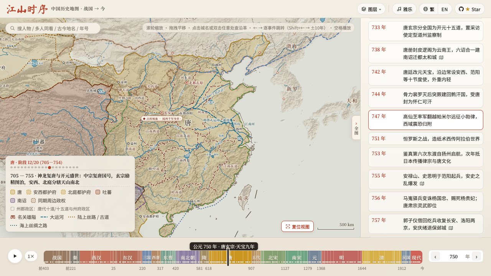
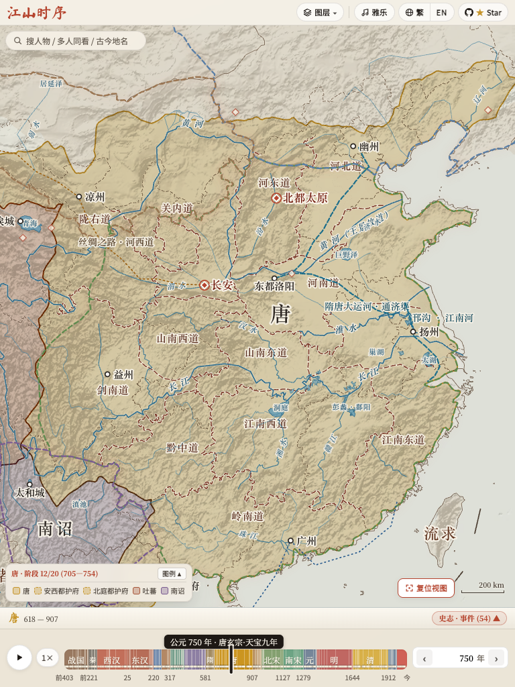
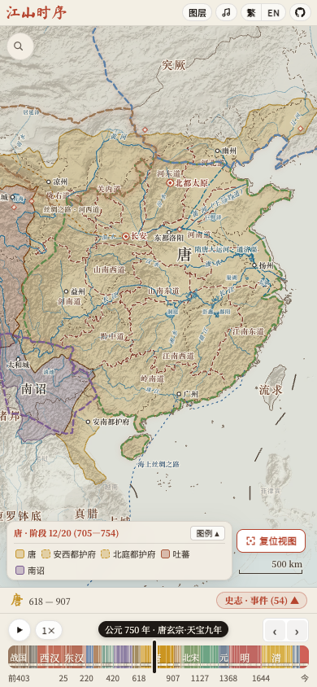

**PR #255 — low-risk SVG subset, 2026-11-04**

This report measures only the [maintainer-requested first subset](https://github.com/DeanChensj/jiangshan-map/pull/255#issuecomment-6638929404), against unmodified main **`ff1392c`**. PR source is **`e7720756ae792845caf6a9644d8fea69f7714e3f`**. Measured fork-lab source is **`5eab48f05c1ea3fbc0406be75e01fad3f6e4553c`**; a [four-file hash manifest](performance/svg-low-risk-source.json) and offline checks bind its app, CSS, HTML and CI validator to the PR source exactly. Runtime app `d2026091` / CSS `638e75af` includes the latest upstream layout and polygon/naming corrections.

Main advanced to `49ae5ed` after timing, adding only README badges. The published PR source `0f3c1b6cca732045f650003c9301639417444c13` preserves all measured runtime/data/CI bytes. [Publication equality record](performance/svg-low-risk-publication-source.json).

The upstream PR changes only `js/app.js`, `css/style.css`, `index.html` and the existing `scripts/validate_atlas.js`. Benchmarks, screenshots, reports, Swift capture tooling and evidence stay on this fork branch. Data, translations, quiz, topic pages and iOS sources have no PR diff. Existing features, first-visit onboarding, labels, controls and 220 ms easing are preserved.

The subset contains guarded SVG attribute writes at the reviewed call sites, indexed/cached region-boundary construction with unchanged predicates, transform-based timeline motion/backdrop isolation, and a dictionary-ready boolean set on initial/lazy locale loading. The always-changing zoom transform loop keeps its direct write. The full implementation, including deferred node reuse, offscreen-label culling, worker and pan-plane experiments, remains on [the preserved full branch](https://github.com/xcv58/jiangshan-map/tree/codex/svg-performance-full-preserved); its FPS numbers are not substituted for this subset's results.

**Actual FPS.** Three alternating pairs per pan, zoom and timeline-playback workload use visible Chrome 156.0.8078.79 on Apple M4 / 16 GiB, 1280×720 CSS viewport, DPR 2, default Metal/Graphite. Trusted pan/zoom lasts four seconds; real 4× event playback lasts ten seconds. The unchanged parser counts Chrome page presentation feedback cross-checked against display feedback. No synthetic animation, RAF FPS proxy, hidden footer, skipped events or backend override is used. Values are medians with full ranges; all final-source runs are retained.

| Workload | Main ff1392c FPS | Low-risk subset FPS |
| --- | ---: | ---: |
| Pan | 59.98 (59.84–60.04) | 59.86 (59.83–59.88) |
| Zoom | 46.66 (37.00–48.24) | 40.49 (38.87–40.50) |
| Playback | 46.57 (46.46–48.77) | 56.97 (56.93–57.79) |

**The primary zoom median is lower, and zoom is slower in two of three paired runs. Playback is faster in all three. The PR remains draft with this observed tradeoff explicitly recorded.** The literal every-run 60 FPS acceptance remains **`passed=false`**. Native/captured observations below are separate and do not replace any primary sample. [All primary runs](performance/svg-low-risk-frames.json.gz), [recomputed analysis](performance/svg-low-risk-frames-analysis.json.gz).

**Independent map-content observation.** A separate three-pair cohort captures ScreenCaptureKit changed pixels in the map ROI, excluding the footer/browser chrome. These are observed changes per second, not physical-display FPS or proof that every layer refreshed. Capture can coalesce samples; intentional holds can be identical, and the first changed sample has one-sample boundary uncertainty.

| Workload | Main native changes, Hz | Subset native changes, Hz |
| --- | ---: | ---: |
| Pan | 59.68 (59.30–60.04) | 59.83 (59.54–60.01) |
| Zoom | 41.10 (34.97–44.35) | 39.34 (35.71–44.37) |
| Playback | 49.29 (46.90–52.37) | 57.80 (57.35–58.13) |

Captured Chrome feedback remains separate: zoom 42.82 → 40.81 FPS; playback 49.39 → 57.50 FPS. All 12 playback observations visit the same 22 event years from 751 through 885. [Captured runs](performance/svg-low-risk-native.json.gz), [native/GPU analysis](performance/svg-low-risk-native-analysis.json.gz), [native metadata](performance/svg-low-risk-native-captures.json.gz).

**Startup and memory.** Three alternating fresh-browser pairs are collected separately from FPS. Readiness requires full snapshots, loaded UI fonts and a settled year-1415 camera; memory is sampled every 250 ms in a separate interaction workload. Values are medians with full ranges; memory is MiB.

| Metric | Main ff1392c | Low-risk subset |
| --- | ---: | ---: |
| Full-scene ready, ms | 1010.1 (776.8–3218.6) | 926.0 (870.6–1108.8) |
| First contentful paint, ms | 524.0 (404.0–2812.0) | 456.0 (412.0–484.0) |
| Startup main-page JS heap | 14.30 (14.28–14.30) | 14.52 (14.52–14.52) |
| Peak sampled main-page JS heap | 41.51 (41.50–44.65) | 45.57 (40.77–45.72) |
| After-interaction main-page JS heap | 22.82 (22.77–22.82) | 22.81 (22.52–22.81) |
| Startup owned-process RSS | 1403.17 (1362.98–1417.31) | 1468.22 (1444.44–1469.72) |
| Peak sampled owned-process RSS | 1592.80 (1583.16–1619.66) | 1605.75 (1602.77–1616.98) |
| After-interaction owned-process RSS | 1525.70 (1502.56–1559.75) | 1520.22 (1483.42–1552.42) |

Startup is faster in 2/3 pairs; sampled peak page heap is lower in 1/3, and peak owned-process RSS in 1/3. Small or mixed differences do not establish a consistent benefit. Page heap excludes workers; summed RSS can double-count shared pages and does not measure unique physical/total GPU memory. Browser profiles are fresh; OS/font/network caches and host load are uncontrolled. [All six startup/memory runs](performance/svg-low-risk-memory.json.gz).

**Feature and CI validation.** All 12 subset validation groups pass: synchronized assets; required atlas CI; independent boundary equivalence; camera/pointer/pinch/hover/resize; callouts; paired feature flows; timeline/onboarding; nine responsive sizes plus rotation; Chrome/native parser fixtures; evidence-tooling regressions; and LAN playback/source checks. Full atlas CI retains 40 CUJs / 2,430 timeline years. Geometry matches across 189 concrete snapshots, 16,433 anchors and six margin/threshold fixtures. The independent unindexed reference and comparisons now live in `scripts/validate_atlas.js`, so the existing required GitHub Actions workflow executes them. A disposable negative control changing the 0.55 boundary margin to 0.16 is rejected by that guard.

Paired browser flows cover year navigation, real playback, search/person pins, place history, routes, polity links, English and Traditional Chinese, quiz answer/next/exit, embed and first-visit onboarding. Responsive checks cover 320×568, 390×844, 640×900, 768×1024, 900×640, 1024×768, 1280×720, 1440×900 and 1920×1080, followed by orientation changes. Control geometry agrees within 0.51 CSS px, final cameras within 0.1 world unit, with no new overflow. Physical-phone/Safari FPS and production INP are not established. [Verification archive](performance/svg-low-risk-verification.json.gz).

Six full, unmasked and unaligned screenshots come from this subset's final responsive run. Animations are frozen only for deterministic static QA, never during FPS collection. Mean RGB difference is 0.0106–0.0223/255; 0.0261–0.0374% of pixels differ by >16 in a channel. This is close static rendering, not moving pixel identity. [Screenshot hashes/differences](performance/svg-low-risk-screenshots.json).

| Viewport | Main | Subset |
| --- | --- | --- |
| 1280x720 |  |  |
| 768x1024 |  |  |
| 390x844 |  |  |

**Recorded host conditions.** Jellyfin PID(s) [12908] and LogiPluginService PID(s) [81073] remain present in all 84 host observations. Neither service was stopped or altered. Observed CPU: Jellyfin 0.10 (0.00–2.30)%; LogiPluginService 0.00 (0.00–12.60)%. One-minute load: 4.25 (3.49–5.47). These are observed conditions, not proof of causality; do not pool with earlier cohorts.

**Retained diagnostic iterations.** The initial extraction guarded the always-changing zoom transforms, adding an unnecessary attribute read before each write. The reviewed full version did not guard that fast loop. Its [complete 18-run primary cohort](performance/svg-low-risk-initial-frames.json.gz) and [partial native collection](performance/svg-low-risk-initial-native-partial.json.gz) remain preserved with [the explicit stop/revision record](performance/svg-low-risk-initial-iteration.json). They describe different source bytes and are not pooled with the corrected subset. The pan-plane-only camera probe was removed from the fork harness. An upstream typography assertion was also stale: unchanged main fails it because scaling already occurs in the coalesced frame. The fork probe now requires exactly one update and no repeated settle work; [harness notes](performance/svg-low-risk-harness-notes.json) record the baseline reproduction. These corrections do not change production camera code.

**Evidence and reproduction.** The assembler verifies 36 trace digests, recomputes FPS with the unchanged counter, aligns 18 native captures, retains six startup/memory observations and checks source/script/log hashes. Fresh invocation IDs reject stale or incomplete output; capture paths are relative and legacy relocation remains supported. All raw traces, capture JSON/PNGs, logs and preliminary failures are retained locally in `/Users/yihong/work/jiangshan-map-svg-low-risk-d2026091-review`; packaged observations and trace digests are linked above. [Readable summary](performance/svg-low-risk-summary.json).

From this fork's evidence branch, serve an unmodified `ff1392c` checkout and the lab checkout with `WEB_BASE_PORT=8834 WEB_PORT=8835 node scripts/serve_web_benchmark.cjs MAIN_CHECKOUT LAB_CHECKOUT`. LAN preview uses `LAN_HOST=192.168.8.31 LAN_MAIN_ROOT=MAIN_CHECKOUT LAN_MAIN_PORT=8836 LAN_CANDIDATE_PORT=8837 node scripts/serve_timeline_comparison.cjs`.

Create a fresh review directory and copy `docs/performance/svg-low-risk-source.json` to `REVIEW/pr-source.json`. Then set `PLAYWRIGHT_PATH`, `WEB_BASE_REF=ff1392c`, `SVG_REVIEW_DIR=REVIEW`, and the LAN URLs before running `node scripts/check_svg_final.cjs`. After validation completes, set `FRAME_CAPTURE_BINARY` to the macOS capture helper and run `node scripts/check_svg_final.cjs --measure-only`, keeping Chrome visible/focused and both services running. After timed collection finishes, run `node --expose-gc scripts/analyze_svg_final.cjs REVIEW OUTPUT`. UI screenshots come from the paired responsive check. No benchmark or evidence file is required by upstream CI or the application.
