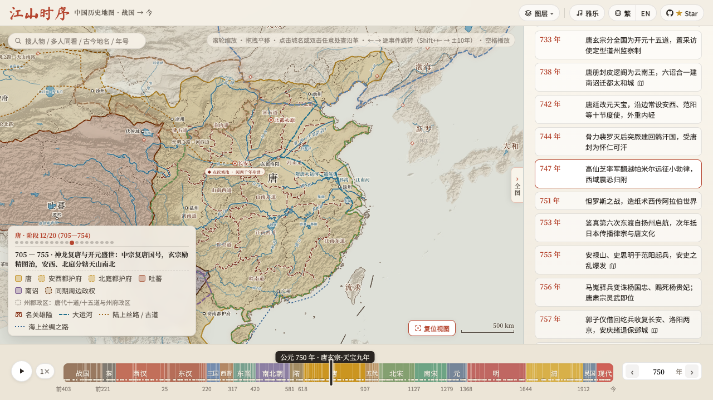
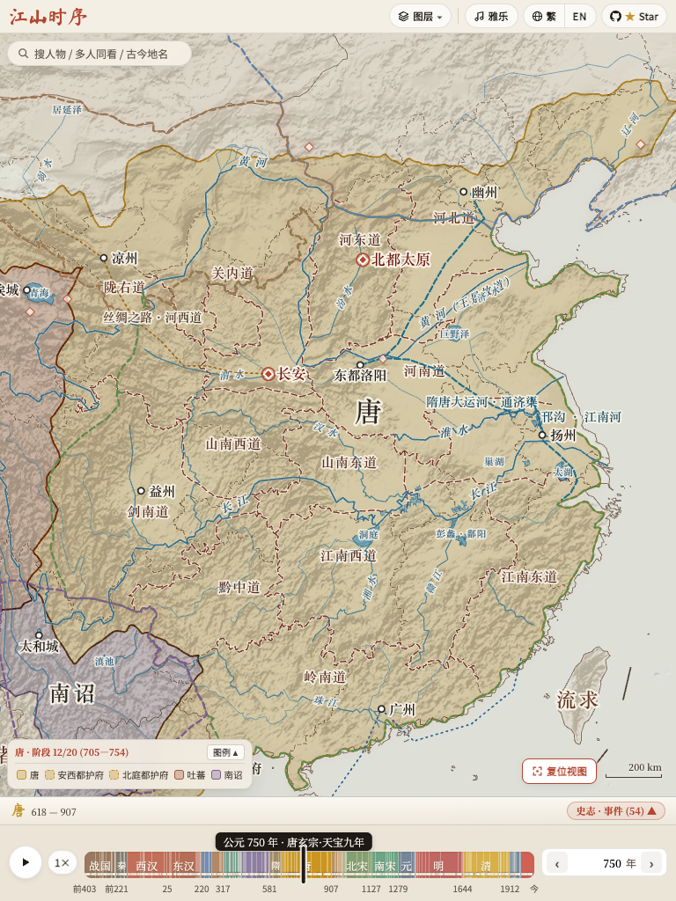
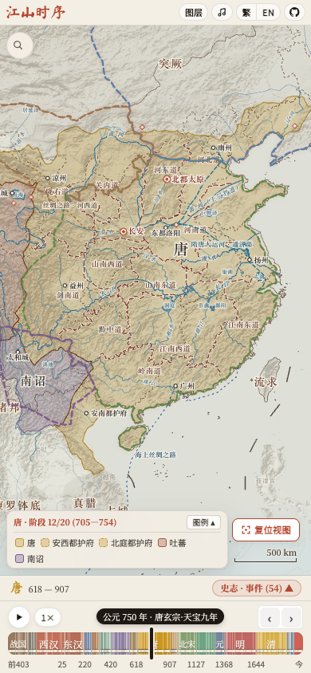

# PR #255: stage-hint removal and final low-risk subset

Measured on 2026-11-04 against unmodified main **`49ae5edeea316af1a223d7727554bc597ea314be`**. PR source **`85354373aa6c69b89400ef8503e82b336f8fa30c`**; measured fork-lab source **`192b32789c62f27be91e5edc856342db3642dbca`**. The [four-file source manifest](performance/svg-stage-hint/source.json) matches both checkouts exactly.

This follow-up removes only `will-change: transform` from `#svg-stage-wrap` and updates the stylesheet cache hash. The wrapper, native SVG `viewBox` camera, typography, controls, 220 ms timeline easing, and onboarding stay intact. The full PR still changes only `js/app.js`, `css/style.css`, `index.html`, and the existing `scripts/validate_atlas.js`. It retains the maintainer-requested attribute guards, boundary-query cache/index, scrubber transforms, dictionary-ready boolean, and boundary equivalence in required CI. Data, translations, quiz, topic pages, and iOS sources have no PR diff. It remains independent of #230.

Node reuse, offscreen-label culling, worker preparation, and the pan-plane implementation remain deferred on the preserved fork branch. Benchmarks, screenshots, capture tools, and reports stay outside the upstream PR.

## Primary actual FPS

Three alternating pairs per workload in visible Chrome 156.0.8078.79 on Apple M4 / 16 GiB / 1280×720 CSS viewport / DPR 2, with the default Metal/Graphite backend. Trusted pan/zoom inputs last four seconds; real 4× event playback lasts ten seconds. The unchanged parser counts unique page presentation-feedback timestamps matched to Chrome display feedback. No RAF FPS proxy, synthetic map animation, backend override, hidden footer, or skipped event is used. Values are medians with full ranges, and every final-source sample is retained.

| Workload | Main FPS | Final subset FPS |
| --- | ---: | ---: |
| Pan | 59.79 (59.50–60.22) | 59.77 (56.74–60.18) |
| Zoom | 39.29 (36.53–40.25) | 57.44 (57.34–57.46) |
| Timeline playback | 47.01 (45.41–48.46) | 57.17 (56.64–57.85) |

Zoom and playback are faster in all three matched primary pairs. Pan has a similar median but is lower in all three pairs, including **one 56.74 FPS run**. The literal every-run 60 FPS target remains **`passed=false`**; the every-run 58 FPS goal is also not established. Slightly above-60 values reflect finite measurement-window counting, not a claim about a higher display refresh rate.

[All primary observations](performance/svg-stage-hint/svg-low-risk-frames.json.gz) · [Recomputed trace analysis](performance/svg-stage-hint/svg-low-risk-frames-analysis.json.gz).

## Separate capture cohort

A second three-pair cohort independently records exact map-region pixel changes through ScreenCaptureKit, excluding browser chrome and the footer. Capture can coalesce frames and has overhead. Changed-pixel Hz describes observed WindowServer content changes, not physical-display FPS or proof that every layer refreshed. Chrome and native results are kept separate from the primary cohort.

| Workload | Main Chrome FPS | PR Chrome FPS | Main native changes, Hz | PR native changes, Hz |
| --- | ---: | ---: | ---: | ---: |
| Pan | 59.87 (59.82–60.23) | 59.95 (59.84–59.97) | 59.63 (59.00–59.82) | 59.73 (59.59–59.95) |
| Zoom | 40.25 (36.23–45.40) | 54.40 (36.49–57.22) | 38.78 (36.72–44.91) | 49.97 (37.23–52.78) |
| Playback | 46.91 (45.72–47.71) | 56.98 (56.51–57.55) | 47.51 (46.02–47.81) | 57.47 (57.40–57.55) |

All three captured zoom and playback pairs improve, but **one captured PR zoom run is only 36.49 FPS**, retained above. This is a median improvement with intermittent slow runs, not uniform 58/60 FPS. All twelve playback observations visit the same 22 event years, 751 through 885.

[Captured observations](performance/svg-stage-hint/svg-low-risk-native.json.gz) · [Native/trace analysis](performance/svg-stage-hint/svg-low-risk-native-analysis.json.gz) · [Native capture metadata](performance/svg-stage-hint/svg-low-risk-native-captures.json.gz).

## Startup and memory

Three alternating fresh-browser pairs are collected separately from FPS, with a 250 ms memory sampler over a separate interaction workload. Readiness includes full snapshots, UI fonts, and a settled year-1415 camera. Medians with full ranges:

| Metric | Main | Final subset |
| --- | ---: | ---: |
| Full-scene ready, ms | 840.6 (741.4–842.1) | 768.1 (745.2–776.4) |
| First contentful paint, ms | 384.0 (380.0–428.0) | 400.0 (376.0–428.0) |
| Startup main-page JS heap, MiB | 14.30 (14.28–14.30) | 14.51 (14.48–14.52) |
| Peak sampled main-page JS heap, MiB | 41.53 (41.41–44.45) | 41.87 (37.76–45.72) |
| After-interaction main-page JS heap, MiB | 22.82 (22.56–22.83) | 22.51 (22.51–22.81) |
| Startup owned-process RSS, MiB | 1471.39 (1468.70–1476.61) | 1457.08 (1337.86–1484.03) |
| Peak sampled owned-process RSS, MiB | 1600.89 (1596.30–1620.88) | 1543.70 (1535.94–1580.86) |
| After-interaction owned-process RSS, MiB | 1557.00 (1524.00–1572.88) | 1505.52 (1488.62–1506.16) |

Median full-scene readiness and owned-process RSS are lower in this batch; median first contentful paint and peak page heap are slightly higher. No general memory-reduction claim is made. Browser profiles are fresh; OS/font/network caches and host load remain uncontrolled. Main-page heap excludes workers; summed RSS may double-count shared pages and is not unique physical or total GPU memory.

[All six startup/memory runs](performance/svg-stage-hint/svg-low-risk-memory.json.gz).

## Functional, responsive, and WebKit validation

All 12 Chromium validation groups pass: synchronized assets; full atlas/40 CUJs and 2,430 timeline years; independent boundary/anchor equivalence; camera/pointer/pinch/hover/resize; callouts; paired features; timeline/onboarding; nine viewports plus rotation; Chrome/native parser fixtures; evidence-tooling regressions; and LAN playback/source checks. Canonical polygon and topology checks from the required workflow also pass locally. Geometry covers 189 snapshots, 16,433 anchors, and six threshold/margin fixtures.

WebKit 26.5 passes paired feature flows, timeline/onboarding, and all nine responsive viewports plus rotation. Covered flows include year navigation, real playback, search/person pins, place history, routes, languages, polity links, quiz answer/next/exit, and embed. First-visit guide/gesture markup and hints match exactly; timeline easing remains 220 ms. Mobile WebKit zoom uses the existing trusted `+` keyboard shortcut because Playwright cannot send wheel input there; desktop WebKit/Chromium use trusted wheel input. These are engine and viewport checks, not physical-iPhone pinch or Safari FPS evidence.

Diagnostic harness corrections, all confined to the fork, are explicit in [harness notes](performance/svg-stage-hint/harness-notes.json):

- The original callout check failed twice on opposite signed 0.03125 CSS-pixel width differences. It now keeps content, caret, position, and height exact while allowing 0.05 CSS pixels for width/right rounding. Both failed runs and same-main controls are retained; the variability mechanism is not isolated.
- The glide test deliberately pauses a transition at 110 ms. WebKit retained that artificial pause after stop; the harness now cancels only that test-created pause before subsequent input/resize checks. A Chromium rerun of this affected check also passes.
- WebKit percentage-transform rounding yields a maximum measured timeline thumb error of **0.46863 CSS pixels**. Checks use the existing responsive suite's **0.51 CSS-pixel** geometry budget and record absolute errors. No application change was added to hide that rounding.

[Chromium verification and logs](performance/svg-stage-hint/svg-low-risk-verification.json.gz) · [WebKit, local workflow checks, corrections, and retained failed logs](performance/svg-stage-hint/supplemental-verification.json.gz).

## Updated screenshots

These full, unmasked, unaligned Chromium screenshots come from this final source's responsive run. Animations are frozen only for static QA. Selected mean RGB differences are 0.0868–0.1802/255; 0.0261–0.0374% of pixels differ by more than 16 in a channel. This establishes close static output, not moving-pixel identity. [All nine image comparisons and hashes](performance/svg-stage-hint/screenshots.json).

| Viewport | Main | Final subset |
| --- | --- | --- |
| 1280×720 |  |  |
| 768×1024 |  |  |
| 390×844 |  |  |

[WebKit desktop screenshot](performance/svg-stage-hint/webkit-candidate-1280x720.png) · [WebKit mobile-viewport screenshot](performance/svg-stage-hint/webkit-candidate-390x844.png).

## Host conditions, earlier diagnosis, and reproduction

Jellyfin PID 12908 and LogiPluginService PID 81073 remain present in all 84 FPS/memory host observations. Observed CPU ranges are 0–0.3% and 0–11.5%, respectively; one-minute load ranges from 3.30 to 7.78. Their presence does not imply constant utilization. Neither service was stopped or altered.

The [earlier 90-run diagnosis](svg-zoom-cause.md) isolated the inherited permanent stage hint as the clearest shared zoom bottleneck. It did not establish the precise cause of the original PR/main 13.2% difference. The [earlier subset report](https://github.com/xcv58/jiangshan-map/blob/8c4e1bc986481aa1c0d8c7412951c6aea82da278/docs/svg-low-risk-performance.md), its slower zoom observations, and all original evidence remain preserved. They are not pooled with this final-source comparison.

Offline assembly verifies **36 trace digests**, reparses all presentation counts with the unchanged counter, aligns **18 native captures**, checks **six startup/memory runs**, verifies script/log versions, and matches the four-file PR source manifest. [Machine-readable summary](performance/svg-stage-hint/svg-low-risk-summary.json).

All raw traces, capture JSON/PNGs, logs, and preliminary validation failures remain in `/Users/yihong/work/jiangshan-map-svg-stage-hint-ef139c48-review`. Packaged observations/digests are linked above; the full raw trace archives are retained locally.

To reproduce, serve a pinned `49ae5ed` checkout and this lab checkout with `scripts/serve_web_benchmark.cjs`. Create a fresh review directory with its `pr-source.json`; set `PLAYWRIGHT_PATH`, `WEB_BASE_REF=49ae5ed`, `WEB_BASE_URL`, `ATLAS_URL`, and `SVG_REVIEW_DIR`. Run `scripts/check_svg_final.cjs`, then `scripts/check_webkit_parity.cjs`; keep Chrome visible/focused and both services running. Set `FRAME_CAPTURE_BINARY` and run `scripts/check_svg_final.cjs --measure-only`. After timed collection stops, run `WEB_BASE_REF=49ae5ed node --expose-gc scripts/analyze_svg_final.cjs REVIEW OUTPUT`.

Local comparison previews: main at `http://192.168.8.31:8876/?year=750&compareplay=1`; final source at `http://192.168.8.31:8877/?year=750&compareplay=1`. The preview-only autoplay helper is not part of the PR.
